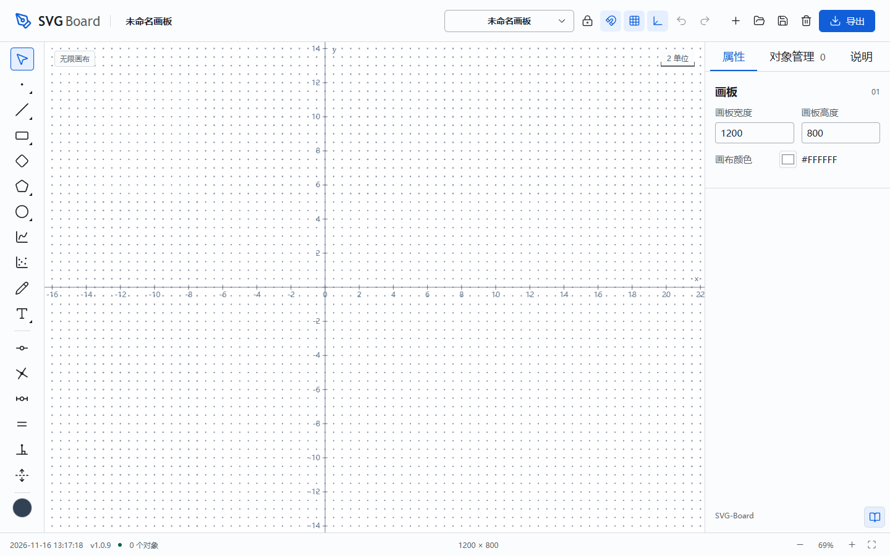
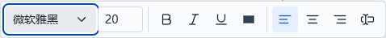

# SVG-Board

这是一份轻量的 SVG 编辑器，它可以便捷地展示关系模型、几何构造等

## 近期版本

| 版本  | 主要变化                                                                               |
| ----- | -------------------------------------------------------------------------------------- |
| 1.0.9 | 坐标轴吸附、连续点名、坐标点文字、曲线解析式与锁标记同步                               |
| 1.0.8 | 分类源码目录、直线与射线、数学坐标轴、批量坐标点、函数绘制、点拟合、角平分线与边框吸附 |
| 1.0.7 | 长按左键平移、几何构造双流程与默认锁定、构造线长度调整、独立存档菜单与重复点击收起     |

## 当前界面



标题栏提供画图存档选择、只读、吸附、网格、撤销重做、文件管理和导出。左侧提供绘图工具与几何构造，图标大小随可用高度调整，带角标的工具可长按切换模式。中间画布支持平移、缩放和底色设置，右侧切换属性、对象管理和项目说明。工作区右下角的说明图标控制侧栏显示，左下角显示日期时间与版本号

## 当前功能罗列

- 矩形、正方形、圆、椭圆、判断框、正多边形、自定义多边形、线段、箭头、贝塞尔曲线、自由画笔、文字和几何点
- 选择、框选、Shift 多选、移动、缩放、旋转、复制粘贴、删除
- 描边、填充、虚线、线宽、透明度、矩形圆角、字体、字号和文字对齐
- 图形和线条标签可选中并转为独立文本，支持移动、编辑和隐藏
- 画布底色随作品保存，网格根据明暗调整点色，图片导出保持透明背景
- 对象管理页集中调整层级、锁定和隐藏，锁定对象显示小锁标记，隐藏仅作用于指定对象
- 只读模式，允许查看、选择和导出，禁止修改作品
- 本地多存档、新建存档、切换存档和删除确认
- 左对齐、顶对齐、水平等距分布、统一宽度
- 默认开启自动吸附，依次优先交点、端点与顶点、边框、网格
- 关联连接线，移动或缩放节点时端点随动
- 线段、射线和直线，射线先点端点，再点方向，直线按两个点确定方向
- 两点直线、中点、直线交点、过点平行线、垂线与角平分线，来源变化后自动重算
- 固定数学坐标轴、动态刻度和右上角比例尺，原点不因保存裁剪改变
- 批量坐标点、单变量函数绘制、线性和多项式拟合，函数曲线与图形边框优先于网格吸附
- 几何构造默认锁定，构造线可沿原方向拖动端点或设置显示长度；对象管理中可手动解锁
- 撤销重做、浏览器自动恢复、项目文件保存与打开
- SVG / PNG 按内容裁剪并使用透明背景，导出窗口可预览图形或下载项目文件
- 本工具导出的 SVG 包含项目元数据，可重新打开并继续编辑
- 可编辑的流程图和三角形中线模板
- 文字选区上方的字体菜单、字号、粗体、斜体、下划线和三个对齐按钮
- 可平移的无限画布，保存时记录内容外框与少量留白，支持负坐标
- 支持 Markdown 的项目说明，随作品保存

文字工具栏将字体菜单、字号、样式和对齐分组显示，选中图形标签后也可使用



## 环境与启动

你需要先下载 Node.js 22.12+，使用当前 Chrome、Edge 或 Firefox

```bash
npm -v
npm ci
npm run dev
```

**之后访问 `http://127.0.0.1:5173` 即可**

双击根目录 `index.html` 时，开发服务运行则进入 `http://127.0.0.1:5173/editor.html`，与手动访问共用页面和浏览器存档；服务关闭则打开 `dist/editor.html` 离线文件。已经打开的离线页会定期检测开发服务，服务恢复后切回网页。`npm run dev` 同时监听源码并重建离线文件。首次离线使用，或源码更新后没有运行开发服务时，执行 `npm run build` 生成最新文件

请注意：浏览器测试的首次运行需要安装 Playwright 的 Chromium，命令如下：

```bash
npx playwright install chromium
npm run test:browser
```

Windows 已安装 Edge 时也可使用 PowerShell：

```powershell
$env:PLAYWRIGHT_CHANNEL = 'msedge'
npm run test:browser
```

## 快捷键设置

线段、箭头、连接线和贝塞尔曲线共用工具分组，横排和竖排文本共用文字分组，矩形和多边形也各有模式分组。长按图标并移向菜单可选择模式，也可聚焦图标后按下箭头展开

图形可以拖动绘制，也可先点击起点、再点击终点。圆先点圆心，再点圆上一点；任意椭圆按两个对角点确定范围。文字按范围设置宽度与字号，几何点点击放置，拖动可调整半径。两点直线工具依次点击两个点，空白处会创建来源点，直线随来源点移动。中点、交点、平行线、垂线和角平分线既可先选来源再点击构造，也可先点击工具再依次点来源；平行线和垂线的线、点顺序不限，角平分线选择两条相交直线。正多边形先设置边数，自定义多边形逐点点击，双击最后一个顶点闭合。曲线绘制后可继续拖动方向控制点。放置后保留当前工具，按 `V` 或点击选择工具后调整对象

点工具长按菜单中的“坐标点”接受多行 `x, y`，也可用分号分隔。新点从 A 到 Z 命名，再依次使用 A1 到 Z1、A2 到 Z2，跳过已经占用的名字；坐标点同样自动显示点名文字。数学坐标纵轴向上，一个单位对应 40 个画布单位，原点固定在初始画板中心。显示中的坐标轴参与优先吸附，关闭坐标轴后不再吸附轴线

函数工具接受 `sin(x)`、`x^2`、`sqrt(x)` 等解析式与绘制范围，属性中可继续修改。点拟合先选中多个几何点，也可直接输入多组坐标；线性拟合使用一阶，多项式拟合支持 1 到 8 阶，点数须大于阶数。曲线旁自动显示解析式，来源点变化后拟合说明同步更新，SVG 和 PNG 导出均保留文字。显示用的系数适当舍入，计算和存档保留原始精度

Ctrl、Command 或 Shift 可增减多选，右键拖动也能框选；多选后单击成员可取消选择。同一位置连续单击可轮换重叠对象，文字优先于线条。线条端点和曲线端点共用自动吸附，连接线中段手柄用于调整折点

常用快捷键：`Ctrl/Command+Z` 撤销、`Ctrl/Command+Shift+Z` 或 `Ctrl+Y` 重做、`Ctrl/Command+C/V` 内部复制粘贴、`Ctrl/Command+S` 保存、`Ctrl/Command+H` 隐藏选区、`Delete` 删除、方向键微移、`Shift+方向键` 移动 10 个单位。`Escape` 可取消绘制或撤回尚未松开鼠标的变换。普通滚轮平移，`Ctrl/Command+滚轮` 缩放。选择工具在空白区按住左键直接拖动可平移；对象上长按后拖动也可平移，或按住空格临时平移。右键拖动和 `Shift+左键拖动` 用于框选。快捷键不干扰输入框和文字编辑

## 保存与边界

标题栏的存档选择栏使用独立菜单切换作品，再次点击选择栏或点击菜单外侧可收起，字体和工具分组菜单也支持重复点击收起。文件区域的加号新建画板并存为独立存档。保存按钮写入当前浏览器存档，项目文件从导出窗口下载。回收站会先显示确认框，再删除当前存档。“说明”图标控制右侧栏显示与隐藏，侧栏提供属性、对象管理和 Markdown 说明。对象管理中的眼睛和锁图标分别控制对应对象的显示与锁定，隐藏来源点后，关联线仍保留显示和计算。标题栏的锁图标切换只读模式，允许查看、选择、平移、缩放和导出

流程图和三角形中线首次使用时写入画图存档，可直接切换与编辑。存档按名称、说明和图形内容去重，相同的空白存档也只保留一份。点名是独立文本框，可单独选中、移动、编辑和隐藏

两份参考存档位于 `examples/course-flow.svgboard.json` 和 `examples/triangle-median.svgboard.json`，可用打开按钮载入。模板更新后运行 `npm run examples` 重新生成

几何构造的锁定限制位置和角度，不阻止来源联动。构造线调整显示长度后仍跟随来源，长度设置也会保存。手动解锁不会立即删除关联；解锁后首次移动、旋转或自由调整端点时，才转成独立对象。点名文本可单独移动

打开入口支持 SVG-Board 项目和带有本工具元数据的 SVG

画布支持持续平移。文件最多 8 MB、2000 个对象，坐标范围为 -100000 至 100000。超大作品的 PNG 按导出尺寸上限缩放。手机可查看、缩放和基本编辑，桌面端更适合精确绘制。组合在作品模型中记录成员关系

## 技术与结构

| 文件                      | 职责                                   |
| ------------------------- | -------------------------------------- |
| `src/app/`                | 应用连接、命令分发与离线入口           |
| `src/core/`               | 作品类型、共享限制、对象命令与撤销历史 |
| `src/canvas/`             | Fabric 交互、对象显示、控制点与坐标轴  |
| `src/geometry/`           | 几何构造、直线裁剪、吸附与框选         |
| `src/math/`               | 数学坐标、函数解析与点拟合             |
| `src/objects/`            | 图形路径、独立标签与内置作品           |
| `src/storage/`            | 存档、文件校验、内容边界与导入导出     |
| `src/ui/`                 | 工具栏、属性、菜单与输入对话框         |
| `src/styles/`             | 布局、动效与共享样式参数               |
| `tests/`                  | 模型与浏览器功能验证                   |
| `scripts/check-style.mjs` | 代码风格检查                           |

## 第三方资源与许可申明

| 资源                        | 版本（当前安装） | 来源                                                                             | 许可                           | 用途                                       |
| --------------------------- | ---------------- | -------------------------------------------------------------------------------- | ------------------------------ | ------------------------------------------ |
| Fabric.js                   | 7.4.0            | [官方仓库](https://github.com/fabricjs/fabric.js)、[文档](https://fabricjs.com/) | MIT                            | 选择框、框选、变换、文字、笔刷、SVG 序列化 |
| Flatten.js                  | 1.6.15           | [官方仓库](https://github.com/alexbol99/flatten-js)                              | MIT                            | 中点、直线交点等二维计算                   |
| Lucide                      | 0.468.0          | [官方仓库](https://github.com/lucide-icons/lucide)                               | ISC，部分图标保留 MIT 来源声明 | 工具栏图标                                 |
| Marked                      | 18.2.0           | [官方仓库](https://github.com/markedjs/marked)                                   | MIT，含 Markdown BSD 声明      | Markdown 解析                              |
| DOMPurify                   | 3.4.18           | [官方仓库](https://github.com/cure53/DOMPurify)                                  | Apache-2.0 / MPL-2.0           | 清理说明预览中的不安全 HTML                |
| mathjs                      | 15.2.0           | [官方仓库](https://github.com/josdejong/mathjs)                                  | Apache-2.0                     | 单变量数学表达式解析与求值                 |
| ML.js Polynomial Regression | 4.0.0            | [官方仓库](https://github.com/mljs/regression-polynomial)                        | MIT                            | 线性与多项式最小二乘拟合                   |
| D3 Array                    | 3.2.5            | [官方仓库](https://github.com/d3/d3-array)                                       | ISC                            | 动态刻度和比例尺分度                       |

流程图、几何模板和界面由本项目创建，没有引用外部照片、数据集或在线字体。字体使用用户系统已有字体，不分发字体文件。完整的运行时依赖声明见 `THIRD_PARTY_NOTICES.md`

Fabric.js 提供对象显示、控制点和变换能力，项目维护作品模型、几何关系、构造命令、文件校验和工作台界面

## AI 工具使用声明

本项目使用 Codex 辅助方案讨论、协助生成部分代码并参与测试检查、问题定位和修复
